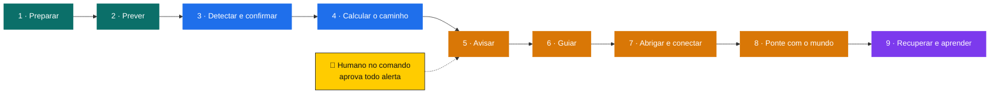

# Omni-EcoRescue Nexus

**Uma rede de proteção em camadas que mantém as pessoas vivas em catástrofes, mesmo quando a internet, a energia e o sinal de celular caem. Agentes de IA trabalham 24 horas; quem decide é sempre um humano.**

> Status: **visão e arquitetura**. O código começa depois de 20/10/2026, tendo como base o [Omni-EcoRescue V3](https://github.com/LeonardoGMendoza/aplicativo-geo-capital-engine-v3) (Tech4Change 2026, Grupo 12), que já funciona com dados reais, IA sobre documentos oficiais e alertas por WhatsApp.

---

## O problema

O Brasil já tem o alarme: o Defesa Civil Alerta faz o celular apitar na área de risco. O que falta é **o que vem depois do alarme**:

- Para onde eu vou? Qual abrigo está aberto e tem vaga?
- Como chego lá se a internet caiu?
- Como os abrigos falam entre si se a cidade ficar isolada?
- Como as famílias se reencontram?
- Em quem confiar quando circulam boatos?

## A solução: defesa em profundidade

Como a defesa de Israel, que tem uma camada para cada distância e tipo de ameaça, o Nexus protege em **9 camadas**. Se uma falha, a próxima segura.

| # | Camada | O que faz | Inspirado em |
|---|---|---|---|
| 1 | **Preparar** | Pessoas treinadas, voluntários, kit da família, dia de simulado | Bangladesh, Warntag (Alemanha) |
| 2 | **Prever (de longe)** | Satélite, previsão do tempo e IA vendo o perigo dias antes | Arrow (Israel), Google Flood Hub |
| 3 | **Detectar e confirmar** | Sensores, relato do cidadão e o agente Juiz com a Nota de Confiança, para não alertar por boato | Celular como sensor (Google) |
| 4 | **Calcular o caminho** | Onde a água ou o fogo vai chegar e quando; só aciona quem está no caminho | Cúpula de Ferro (Israel) |
| 5 | **Avisar** | WhatsApp, SMS, app, alto-falante do abrigo, com o **SIM humano** | IPAWS (EUA), MoWaS (Alemanha) |
| 6 | **Guiar** | Rota e abrigo mais perto, funcionando até sem internet ("modo Spotify") | Comando da Frente Interna (Israel) |
| 7 | **Abrigar e conectar** | Nó Nexus no abrigo: Wi-Fi local, rádio LoRa, IA local, energia solar | Q-ANPI (Japão) |
| 8 | **Ponte com o mundo** | Satélite quando a cidade fica isolada | Starlink, BeiDou |
| 9 | **Recuperar e aprender** | Reencontrar famílias, organizar ajuda, relatório do que funcionou | Agente Relator |

### 3 proteções que atravessam todas as camadas

- 🛡️ **Defesa contra ataques:** hacker, alerta falso ou derrubada do servidor. Senhas só no servidor, código do operador, registros que ninguém apaga e servidores em lugares diferentes.
- ⚡ **Energia:** painel solar e bateria nos pontos críticos. Sem energia, nenhuma camada funciona.
- ⚖️ **As Leis do Enxame:** o humano no comando, em todas as camadas. Ver [docs/LEIS.md](docs/LEIS.md).

## O Enxame: agentes de IA com funções separadas

Sentinela, Mecânico, Juiz, Ouvinte, Analista, Redator, Despachante, Atendente, Guardião do Abrigo e Relator. Cada um faz só a sua parte; nenhum envia alerta sem a aprovação humana. Ver [docs/ENXAME.md](docs/ENXAME.md).

## Documentos

| Documento | Conteúdo |
|---|---|
| [docs/LEIS.md](docs/LEIS.md) | As Leis do Enxame (inspiradas em Asimov) e como viram trava no código |
| [docs/ENXAME.md](docs/ENXAME.md) | Os agentes, o que cada um pode e não pode fazer |
| [docs/PLANO.md](docs/PLANO.md) | Fases de construção, do primeiro agente ao satélite |
| [docs/TECNOLOGIAS.md](docs/TECNOLOGIAS.md) | Tecnologias usadas no mundo e as escolhidas para o Nexus |
| [docs/REFERENCIAS.md](docs/REFERENCIAS.md) | Sistemas de alerta de 15 países e organizações, com links |

## Princípios

1. **Dados reais, com fonte.** Nada inventado; quando a confiança é baixa, o sistema diz.
2. **Humano no comando.** A IA recomenda; uma pessoa decide.
3. **Funciona quando tudo cai.** Cada camada tem um plano para a falha da anterior.
4. **Tecnologia que passa de mão em mão.** Simples, documentada e de baixo custo, para outras pessoas manterem.
5. **Para todos.** Serviço de proteção para qualquer pessoa, em qualquer lugar.

## Autor

Leonardo Junior Gonzales Mendoza. Evolução do Omni-EcoRescue V3, criado com Felipe Eunilio Vieira dos Santos e Helton Rosa da Silva Abadia (Tech4Change 2026, Grupo 12).
