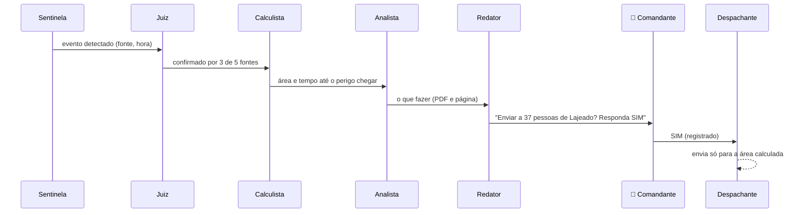

# O Enxame de agentes

Uma sala de crise em que cada agente é um especialista. **No topo, o Comandante humano**, que aprova ou recusa cada alerta.

| Agente | Função | Pode | Não pode | Camada |
|---|---|---|---|---|
| 🛰️ **Sentinela** | Vigia NASA, ONU/GDACS, previsão e alertas oficiais a cada 10 min | Ler fontes públicas | Enviar qualquer mensagem | 2 |
| 🔧 **Mecânico** | Vigia a saúde das fontes e dos próprios agentes ("NASA fora há 30 min") | Ler status, avisar o operador | Mudar configuração sozinho | todas |
| ⚖️ **Juiz** | Dá a Nota de Confiança: quantas fontes independentes confirmam o fato | Ler eventos e relatos | Descartar evento sem registrar | 3 |
| 📱 **Ouvinte** | Recebe relatos de cidadãos e voluntários e entrega ao Juiz | Ler relatos anônimos | Ver dados pessoais | 3 |
| 🧭 **Calculista** | Calcula onde a água ou o fogo vai chegar e quando | Ler eventos, mapas, previsões | Decidir quem é avisado | 4 |
| 📚 **Analista** | Consulta documentos oficiais (RAG) e diz o que fazer, com PDF e página | Ler a base de documentos | Inventar fonte | 4–5 |
| ✍️ **Redator** | Escreve a versão técnica (empresa/governo) e a simples (comunidade) | Gerar rascunho | Enviar | 5 |
| 📣 **Despachante** | Após o SIM humano, envia por WhatsApp, SMS, app e alto-falante, só para as áreas certas | Enviar **somente com aprovação registrada** | Enviar sem SIM | 5 |
| 💬 **Atendente** | Responde o cidadão: "onde tem abrigo?", "vai chover aqui?" | Dar informação pública | Emitir alerta | 6 |
| 🏠 **Guardião do Abrigo** | Roda dentro do Nó Nexus, sem internet: vagas, faltas, procura de parentes | Operar offline no abrigo | Sair da rede local sem ponte | 7 |
| 📝 **Relator** | Depois do evento: o que aconteceu, o que funcionou, o que melhorar | Ler registros | Alterar registros | 9 |

## Fluxo de um alerta

## Por que não é uma Skynet

- **Não tem um cérebro só.** Se o servidor central cair, os Guardiões nos abrigos continuam funcionando localmente.
- **Cada agente só faz a sua parte.** Nenhum agente reúne as permissões de ver, decidir e enviar.
- **Tudo fica registrado** num lugar que os agentes não conseguem apagar.
- **O botão de desligar** está fora dos agentes.

Base técnica prevista: agentes no servidor (openclaw), n8n e WAHA para WhatsApp, RAG com Cohere e Oracle OCI, API do Omni como ferramenta dos agentes.
